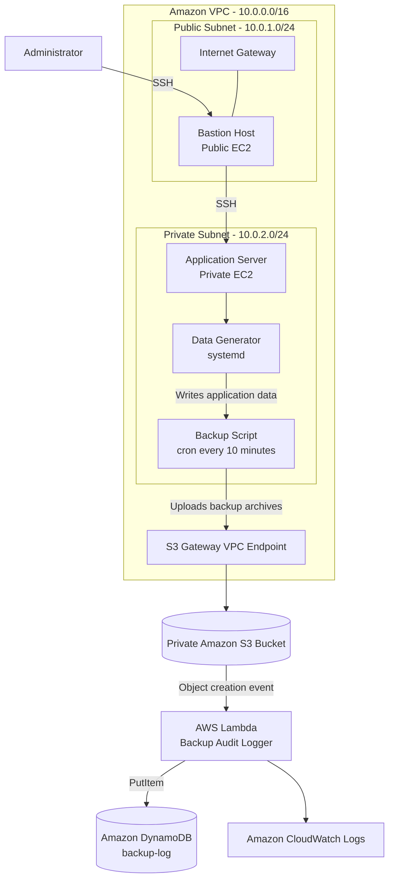

# System Architecture

The diagram below illustrates the network infrastructure and automated backup workflow.

## Backup Workflow

1. The data generator writes application data every 30 seconds.
2. Cron executes the backup script every 10 minutes.
3. The script compresses the application data and uploads the archive to S3.
4. The S3 Gateway VPC Endpoint provides private connectivity to S3.
5. S3 sends an object creation event to Lambda.
6. Lambda records the backup metadata in DynamoDB.
7. Lambda execution logs are captured in CloudWatch.

**Network note:** A NAT Gateway was used temporarily during setup to install software on the private server. It was deleted after installation. The S3 Gateway VPC Endpoint allows backups to continue without it.
