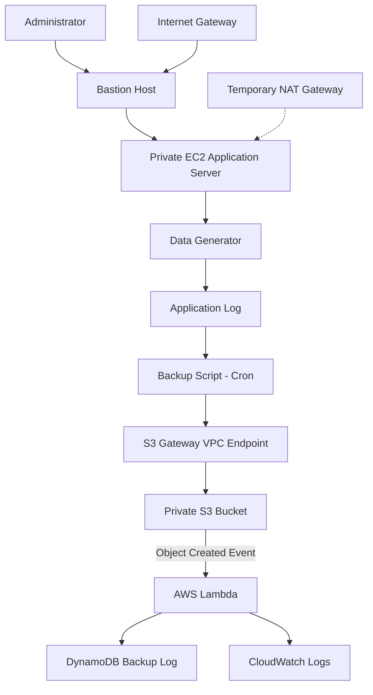

# System Architecture

This diagram illustrates the infrastructure and automated backup workflow.

## Backup Workflow

1. The data generator creates application data every 30 seconds.
2. Cron runs the backup script every 10 minutes.
3. The script compresses the application data.
4. The archive is uploaded to S3 through the Gateway VPC Endpoint.
5. S3 triggers the Lambda function.
6. Lambda records backup metadata in DynamoDB.
7. CloudWatch captures Lambda execution logs.

The NAT Gateway was used temporarily during software installation and removed after setup.
